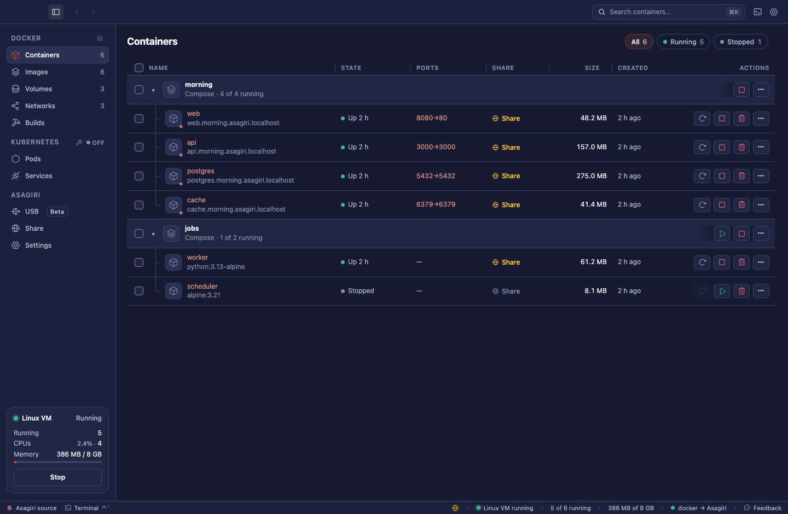

<div dir="rtl">

این راهنمای فارسی Asagiri است. فایل انگلیسی [README.md](README.md) مرجع اصلی است.

<p align="center">
  <picture>
    <source media="(prefers-color-scheme: dark)" srcset="brand/logo/asagiri-horizontal-dark.svg">
    
  </picture>
</p>
<p align="center"><b>朝霧 · مه صبحگاهی</b><br>یک موتور سریع و سازگار با Docker.</p>
<p align="center"><a href="https://andrekurait.github.io/asagiri/">وب‌سایت و نمایش آزمایشی</a> · <a href="https://github.com/AndreKurait/asagiri/releases">دانلود</a> · <a href="docs/development.md">توسعه</a> · <a href="UPSTREAM.md">تاریخچهٔ بالادست</a></p>

Asagiri کانتینرهای Linux را روی **macOS، Linux و Windows** اجرا می‌کند و با API موتور Docker کار می‌کند. می‌توانید از Docker CLI، Compose، buildx و SDKهای Docker استفاده کنید یا کانتینرها را در برنامهٔ بومی مدیریت کنید. رابط‌های اختیاری [مرورگر محلی و MCP](docs/integrations.md) دسترسی محدود به کانتینرها و مجوزهای جداگانه برای تغییرات فراهم می‌کنند. موتور با Rust نوشته شده است.



تصویر و نمایش مرورگر از داده‌های نمونه در رابط واقعی برنامه استفاده می‌کنند.

## امکانات

- ابزارهای آشنای Docker، همراه با یک موتور کوچک و برنامهٔ بومی دسکتاپ.
- مدیریت کانتینرها، ایمیج‌ها، والیوم‌ها، شبکه‌ها، لاگ‌ها، ترمینال‌ها و منابع.
- پنجره و راه‌اندازی به ۳۸ زبان، از جمله فارسی، عربی و کوردیِ ناوەندی با نمایش راست‌به‌چپ.
- ماشین مجازی Linux روی macOS، ‏WSL 2 روی Windows و اجرای بومی کانتینرها روی Linux.
- نام‌های محلی کانتینرها برای توسعه، به‌همراه Kubernetes و ماشین‌های Linux.
- آزمون‌های CI برای پلتفرم‌های مختلف، آزمون‌های زندهٔ سازگاری با API داکر و [تاریخچهٔ کارایی بر اساس commit](https://andrekurait.github.io/asagiri/performance/).

[مقایسهٔ موتورها](docs/engine-comparison.md) اندازه‌گیری‌های Asagiri، Docker و Podman روی Linux را با داده‌های خام و مراحل اجرای دوباره ارائه می‌کند. ابزار اندازه‌گیری می‌تواند از سوکت Colima انتخاب‌شده توسط کاربر هم استفاده کند. نتیجهٔ یک محیط یا بار کاری به معنای برتری در همهٔ محیط‌ها نیست.

## دانلود و نصب

برای دانلود مستقیم برنامهٔ Mac، نصب با Homebrew و راه‌اندازی روی Amazon Linux 2023، [راهنمای نصب](https://andrekurait.github.io/asagiri/install/) را بخوانید:

</div>

```sh
curl -fsSL https://andrekurait.github.io/asagiri/install.sh | sh
```

<div dir="rtl">

این فرمان معماری دستگاه را تشخیص می‌دهد و فایل دانلودشده را بررسی می‌کند. روی Amazon Linux 2023 مخزن امضاشدهٔ RPM را تنظیم می‌کند، ابزارهای Docker را نصب می‌کند و موتور را برای حساب شما راه می‌اندازد. روی macOS برنامه را نصب می‌کند؛ سپس Asagiri را از پوشهٔ Applications باز کنید.

برای نصب با Homebrew:

</div>

```sh
brew install --cask andrekurait/asagiri/asagiri
```

<div dir="rtl">

همهٔ بسته‌ها و نصب‌کننده‌ها در [صفحهٔ انتشار](https://github.com/AndreKurait/asagiri/releases) قرار دارند. ساخت موفق شاخهٔ اصلی به‌طور خودکار یک پیش‌انتشار می‌سازد؛ نسخه‌های پایدار با برچسب نسخه منتشر می‌شوند. فایل‌ها شامل بسته‌های Linux، برنامه‌های macOS، نصب‌کننده‌های Windows، جمع‌های بررسی و اطلاعات منشأ ساخت هستند.

محدودیت‌های هر انتشار را بخوانید: برنامه‌های macOS تأیید notarization اپل ندارند و نصب‌کننده‌های Windows با Authenticode امضا نشده‌اند. Homebrew و DNF بسته‌ها را به‌روز می‌کنند. برنامهٔ دسکتاپ به‌صورت پیش‌فرض فید به‌روزرسانی را بررسی نمی‌کند. جزئیات در [انتشار خودکار](RELEASES.md) و [بسته‌بندی](packaging/README.md) آمده است.

## ساخت از سورس

</div>

```sh
git clone https://github.com/AndreKurait/asagiri.git
cd asagiri
```

<div dir="rtl">

از یک نسخهٔ پایدار و به‌روز Rust استفاده کنید. ساخت مهمان، کرنل، بسته‌های Linux و موتور Windows به یک موتور Docker فعال هم نیاز دارد.

| پلتفرم | فرمان ساخت | خروجی |
| --- | --- | --- |
| macOS | `cargo xtask app-dev` | `target/Asagiri Dev.app` |
| موتور Linux | `cargo xtask linux` | موتور ایستا و عامل مهمان در `target/` |
| Windows | `cargo xtask windows-dev` | `target/asagiri-windows-x86_64/` |

برای Macهای Intel گزینهٔ `--arch x86_64` و برای Windows روی Arm گزینهٔ `--arch arm64` را اضافه کنید. پیش‌نیازها و روش اجرای ساخت در [راهنمای توسعه](docs/development.md) و جزئیات نصب‌کننده‌ها در [راهنمای بسته‌بندی](packaging/README.md) آمده است.

پس از راه‌اندازی، از context داکر Asagiri استفاده کنید:

</div>

```sh
docker --context asagiri run --rm alpine echo 'Good morning, Asagiri'
docker --context asagiri compose up -d
```

<div dir="rtl">

اشتراک‌گذاری به سرور سازگار خودتان نیاز دارد. Asagiri سرویس میزبانی‌شدهٔ اشتراک‌گذاری ارائه نمی‌کند؛ [راهنمای اشتراک‌گذاری](docs/sharing.md) را بخوانید.

## تفاوت با Kiri

Asagiri نام، شناسهٔ برنامه، پوشه‌های داده، سوکت، شناسهٔ نصب‌کننده، تصاویر و زیرساخت انتشار مستقل دارد. نصب‌های Kiri هویت خود را حفظ می‌کنند و داده‌ها به‌طور خودکار منتقل نمی‌شوند.

این مخزن تغییرات بیشتری برای سازگاری با Docker دارد: رقابت‌های چرخهٔ عمر، رفتار HTTP و آرشیو، اتصال SDK، محدودیت منابع، پروفایل‌های seccomp و شبکه‌های bridge، macvlan و ipvlan. اصلاحات بازبینی‌شدهٔ بالادست نیز در آن قرار دارند. منابع تغییرات، پیگیری‌ها و محدودیت‌های باقی‌مانده در [UPSTREAM.md](UPSTREAM.md) ثبت می‌شوند.

## پیشینه و اعتبار

Asagiri یک فورک مستقل از [Kiri](https://github.com/libracoder/kiri)، ساختهٔ libracoder و مشارکت‌کنندگان Kiri، است. این پایه و نام نویسندگان تغییرات حفظ می‌شوند. Asagiri وابسته به پروژهٔ Kiri یا Canestack Labs نیست و از سوی آن‌ها تأیید نشده است. سرویس‌ها، فایل‌های انتشار و علائم تجاری Kiri متعلق به صاحبان خود هستند.

**Asagiri** ‏(朝霧) به معنای «مه صبحگاهی» است؛ واژهٔ ژاپنی *kiri* ‏(霧) به معنای «مه» است. نشان طلوع خورشید از میان سه نوار مه، با هویتی مستقل، به این پیشینه اشاره می‌کند.

مجوز این مخزن [Apache-2.0](LICENSE) است. اعتبار و متن مجوز اجزای شخص ثالث در [NOTICE](NOTICE) آمده است. کرنل Linux که جداگانه توزیع می‌شود، [پیشنهاد منبع](guest/kernel/SOURCE_OFFER.md) و مجوز GPL-2.0-only خود را دارد.

این راهنما با استفاده از [ترجمهٔ فارسی Kiri توسط Sadeq N. Yazdi](https://github.com/libracoder/kiri/pull/271) برای مستندات و محدودیت‌های Asagiri بازنویسی شده است.

## مشارکت

[CONTRIBUTING.md](CONTRIBUTING.md) را بخوانید و اشکال‌ها را در همین مخزن گزارش کنید. برای مسائل امنیتی از [گزارش خصوصی آسیب‌پذیری](https://github.com/AndreKurait/asagiri/security/advisories/new) استفاده کنید. فایل‌های قدیمی اندازه‌گیری و یادداشت‌های انتشار Kiri اعتبار اصلی خود را حفظ می‌کنند؛ آن‌ها اندازه‌گیری یا انتشار Asagiri نیستند.

</div>
