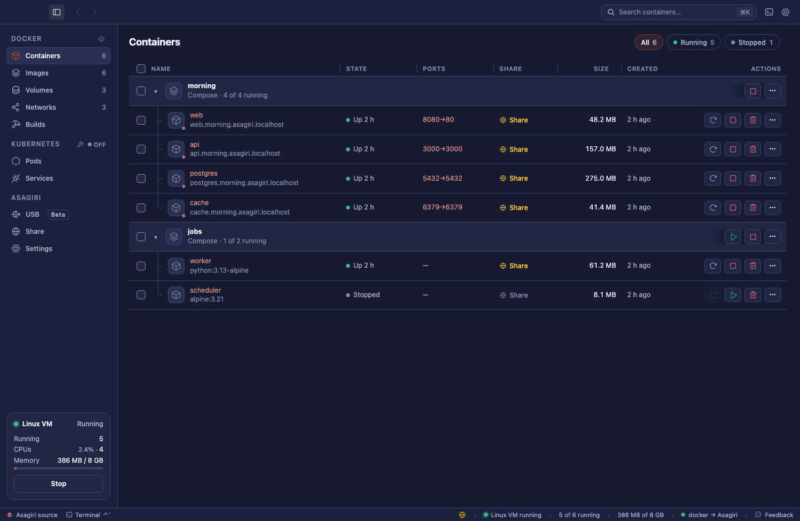

<p align="center">
  <picture>
    <source media="(prefers-color-scheme: dark)" srcset="brand/logo/asagiri-horizontal-dark.svg">
    
  </picture>
</p>
<p align="center"><b>朝霧 · Morning mist</b><br>A fast Docker-compatible engine. A fresh start.</p>
<p align="center"><a href="https://andrekurait.github.io/asagiri/">Website & demo</a> · <a href="https://github.com/AndreKurait/asagiri/releases">Downloads</a> · <a href="docs/development.md">Development</a> · <a href="UPSTREAM.md">Upstream history</a> · <a href="README.pt-BR.md">Português brasileiro</a> · <a href="README.fa.md">فارسی</a></p>

Asagiri runs Linux containers on **macOS, Linux, and Windows** and speaks the
Docker Engine API. Use the Docker CLI, Compose, buildx, and Docker SDKs, or
manage your containers in the native app. Optional [local browser and MCP
interfaces](docs/integrations.md) provide bounded container access with
separate permissions for changes. The engine is written in Rust.



The screenshot and browser demo use sample data in the real app UI.

## What you get

- Familiar Docker tools, with a small engine and a native desktop app.
- Containers, images, volumes, networks, logs, terminals, and resource controls.
- A window and setup in 39 languages, including Armenian and right-to-left Arabic, Persian, and Central Kurdish.
- A Linux VM on macOS, WSL 2 on Windows, and native containers on Linux.
- Container names for local development, plus Kubernetes and Linux machines.
- Cross-platform CI, live Docker API conformance tests, and
  [performance history by commit](https://andrekurait.github.io/asagiri/performance/).
  The [engine comparison](docs/engine-comparison.md) measures Asagiri, Docker
  and Podman on Linux, with raw results and reproduction steps, and can also
  test a user-selected Colima socket.

## Performance and validation

Each complete Linux comparison records **6,000 measurements**: 400 samples
for each of five operations across Asagiri, Docker and Podman, after warmup.
It uses the same Alpine image and checks the returned data and test cleanup.

One November 16, 2026 CI measurement recorded these **median times in
milliseconds**; lower is better:

| Operation | Asagiri | Docker | Podman |
| --- | ---: | ---: | ---: |
| Create, start, exit and remove a container | 7.89 | 116.08 | 40.09 |
| Execute a command and check its result | 1.97 | 37.96 | 54.05 |
| Upload, download and verify a 64 KiB file | 1.75 | 3.98 | 194.22 |
| List an empty container set | 0.19 | 0.30 | 0.39 |
| API ping | 0.20 | 0.40 | 0.40 |

That same measurement caught a cleanup regression: Asagiri's lifecycle
**p95 was 259 ms**, and 32 of 400 runs exceeded 240 ms after the container
exited. Docker's p95 was 123 ms and Podman's was 47 ms. This is why the
reports retain every sample and include cleanup in the lifecycle timing.
The [source, raw results and investigation](docs/engine-comparison.md#investigated-lifecycle-cleanup-regression-workload-v2)
identify the tested revision; these are CI measurements, not a stable-release
or general application-speed claim.

An optional comparison runs two revisions on the same machine in
baseline/candidate/candidate/baseline order, retaining **24,000 samples**.
The [verified cgroup fix comparison](docs/engine-comparison.md#verified-cgroup-fix-comparison)
reduced lifecycle samples above 240 ms from **40/800 to 0/800**. Its median
was nearly unchanged, 4.524 to 4.577 ms; p95 fell from 8.512 to 5.849 ms.
This measured improvement in long delays applies to those tested revisions
and that host. The raw samples, executable hashes and cleanup evidence are retained.

Separate compatibility tests cover volume metadata and removal, package
reinstallation and activation, and guest filesystem notifications and
loop-device persistence. These small API workloads do not measure database
throughput, builds, large-file throughput, VM startup or network speed.
Verus checks the production address-gap search used by IPAM; the
[proof and its boundaries](docs/verified-ipam.md) describe that specific scope.

## Downloads

Start with the [installation guide](https://andrekurait.github.io/asagiri/install/)
for direct Mac downloads, Homebrew, and Amazon Linux 2023 setup:

```sh
curl -fsSL https://andrekurait.github.io/asagiri/install.sh | sh
```

The command detects the architecture and verifies the download. On Amazon
Linux 2023 it configures the signed RPM repository, installs the Docker tools,
and sets up the engine for your account. On macOS it installs the app; open
Asagiri from Applications afterward.

Homebrew users can run `brew install --cask andrekurait/asagiri/asagiri`.
Find all packages and installers on the [release page](https://github.com/AndreKurait/asagiri/releases).
Successful main builds publish automatic prereleases; stable releases use version
tags. Downloads include Linux packages, macOS apps, Windows installers, checksums,
and build provenance. Read each release's platform limits: macOS apps are not
notarized, and Windows installers are not Authenticode signed.

Homebrew and DNF provide package updates. The desktop app does not check an
update feed by default. See [release automation](RELEASES.md) and
[packaging](packaging/README.md) for installation and verification.

## Build from source

```sh
git clone https://github.com/AndreKurait/asagiri.git
cd asagiri
```

Use a current stable Rust toolchain. The bundled guest, kernel, Linux packages,
and Windows engine also need a working Docker engine.

| Platform | Build | Output |
| --- | --- | --- |
| macOS | `cargo xtask app-dev` | `target/Asagiri Dev.app` |
| Linux engine | `cargo xtask linux` | static engine and guest agent in `target/` |
| Windows | `cargo xtask windows-dev` | `target/asagiri-windows-x86_64/` |

For Intel Macs, add `--arch x86_64`; for Windows on Arm, add `--arch arm64`.
See [development](docs/development.md) for prerequisites, platform details, and
running a build, and [packaging](packaging/README.md) for installers.

Once Asagiri is set up, use its Docker context:

```sh
docker --context asagiri run --rm alpine echo 'Good morning, Asagiri'
docker --context asagiri compose up -d
```

Sharing requires your own compatible server. Asagiri does not operate a hosted
sharing service; see [sharing](docs/sharing.md).

## What differs from Kiri

Asagiri has its own name, app identity, state directories, socket, installer
identity, visual assets, and release infrastructure. Kiri installations keep
their own identity. Data is not migrated automatically.

This tree integrates additional Docker compatibility work: lifecycle races,
HTTP and archive behavior, SDK attach, resource limits, seccomp profiles, and
bridge, macvlan, and ipvlan networking. It also carries reviewed upstream fixes.
[UPSTREAM.md](UPSTREAM.md) records sources, follow-ups, and remaining limitations.

## Lineage and attribution

Asagiri is an independent fork of [Kiri](https://github.com/libracoder/kiri),
created by libracoder and the Kiri contributors. It shares that foundation and
preserves contributor authorship. It is not affiliated with or endorsed by the
Kiri project or Canestack Labs. Kiri's services, release binaries, and trademarks
belong to their respective owners.

**Asagiri** (朝霧) means *morning mist*; *kiri* (霧) means *mist*. Our sun rising
through three bars of mist acknowledges that lineage with a distinct mark.

The workspace is licensed under [Apache-2.0](LICENSE). Third-party attribution
and license texts are in [NOTICE](NOTICE). The separately distributed Linux
kernel has its own GPL-2.0-only [source offer](guest/kernel/SOURCE_OFFER.md).

## Contribute

Read [CONTRIBUTING.md](CONTRIBUTING.md), report bugs in this repository, and use
[private vulnerability reporting](https://github.com/AndreKurait/asagiri/security/advisories/new)
for security issues. Historical benchmark files and Kiri release notes retain
their original attribution; they are not measurements or releases of Asagiri.
