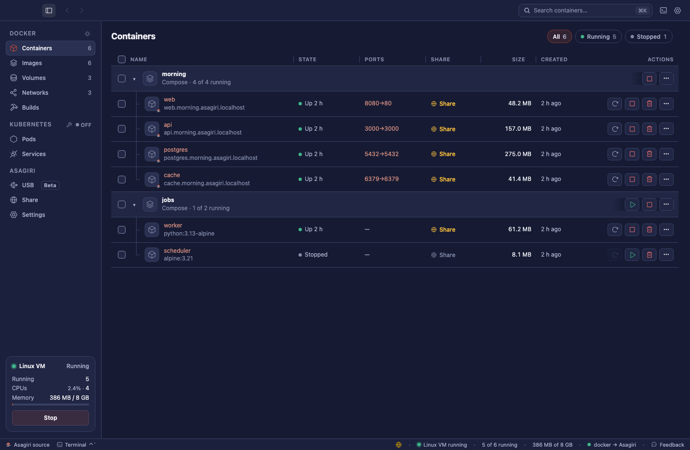

<p align="center">
  <picture>
    <source media="(prefers-color-scheme: dark)" srcset="brand/logo/asagiri-horizontal-dark.svg">
    
  </picture>
</p>
<p align="center"><b>朝霧 · Morning mist</b><br>A fast Docker-compatible engine. A fresh start.</p>
<p align="center"><a href="https://andrekurait.github.io/asagiri/">Website & demo</a> · <a href="https://github.com/AndreKurait/asagiri/releases">Downloads</a> · <a href="docs/development.md">Development</a> · <a href="UPSTREAM.md">Upstream history</a> · <a href="README.pt-BR.md">Português brasileiro</a></p>

Asagiri runs Linux containers on **macOS, Linux, and Windows** and speaks the
Docker Engine API. Use the Docker CLI, Compose, buildx, and Docker SDKs, or
manage your containers in the native app. The engine is written in Rust.



The screenshot and browser demo use sample data in the real app UI.

## What you get

- Familiar Docker tools, with a small engine and a native desktop app.
- Containers, images, volumes, networks, logs, terminals, and resource controls.
- A window and setup in 16 languages, including right-to-left Arabic.
- A Linux VM on macOS, WSL 2 on Windows, and native containers on Linux.
- Container names for local development, plus Kubernetes and Linux machines.
- Cross-platform CI, live Docker API conformance tests, and performance checks.

## Downloads

Find packages and installers on the [release page](https://github.com/AndreKurait/asagiri/releases).
Successful main builds publish automatic prereleases; stable releases use version
tags. Downloads include Linux packages, macOS apps, Windows installers, checksums,
and build provenance. Read each release's platform limits: macOS apps are not
notarized, and Windows installers are not Authenticode signed.

Asagiri has no default update feed. See [release automation](RELEASES.md) and
[packaging](packaging/README.md) for installation and verification.

## Build from source

```sh
git clone https://github.com/AndreKurait/asagiri.git
cd asagiri
```

Use a current stable Rust toolchain. The bundled guest, kernel, Linux packages,
and Windows engine also need a working Docker engine.

| Platform | Build | Output |
| --- | --- | --- |
| macOS | `cargo xtask app-dev` | `target/Asagiri Dev.app` |
| Linux engine | `cargo xtask linux` | static engine and guest agent in `target/` |
| Windows | `cargo xtask windows-dev` | `target/asagiri-windows-x86_64/` |

For Intel Macs, add `--arch x86_64`; for Windows on Arm, add `--arch arm64`.
See [development](docs/development.md) for prerequisites, platform details, and
running a build, and [packaging](packaging/README.md) for installers.

Once Asagiri is set up, use its Docker context:

```sh
docker --context asagiri run --rm alpine echo 'Good morning, Asagiri'
docker --context asagiri compose up -d
```

Sharing requires your own compatible server. Asagiri does not operate a hosted
sharing service; see [sharing](docs/sharing.md).

## What differs from Kiri

Asagiri has its own name, app identity, state directories, socket, installer
identity, visual assets, and release infrastructure. Kiri installations keep
their own identity. Data is not migrated automatically.

This tree integrates additional Docker compatibility work: lifecycle races,
HTTP and archive behavior, SDK attach, resource limits, seccomp profiles, and
bridge, macvlan, and ipvlan networking. It also carries reviewed upstream fixes.
[UPSTREAM.md](UPSTREAM.md) records sources, follow-ups, and remaining limitations.

## Lineage and attribution

Asagiri is an independent fork of [Kiri](https://github.com/libracoder/kiri),
created by libracoder and the Kiri contributors. It shares that foundation and
preserves contributor authorship. It is not affiliated with or endorsed by the
Kiri project or Canestack Labs. Kiri's services, release binaries, and trademarks
belong to their respective owners.

**Asagiri** (朝霧) means *morning mist*; *kiri* (霧) means *mist*. Our sun rising
through three bars of mist acknowledges that lineage with a distinct mark.

The workspace is licensed under [Apache-2.0](LICENSE). Third-party attribution
and license texts are in [NOTICE](NOTICE). The separately distributed Linux
kernel has its own GPL-2.0-only [source offer](guest/kernel/SOURCE_OFFER.md).

## Contribute

Read [CONTRIBUTING.md](CONTRIBUTING.md), report bugs in this repository, and use
[private vulnerability reporting](https://github.com/AndreKurait/asagiri/security/advisories/new)
for security issues. Historical benchmark files and Kiri release notes retain
their original attribution; they are not measurements or releases of Asagiri.
