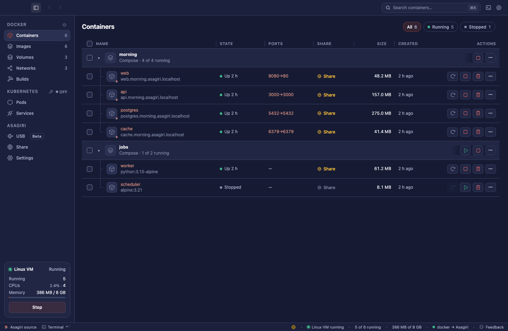

<p align="center"></p>
<p align="center"><b>朝霧 · Névoa da manhã</b><br>Um mecanismo rápido e compatível com Docker. Um novo começo.</p>

[English](README.md) · [Site e demonstração](https://andrekurait.github.io/asagiri/)

O Asagiri executa contêineres Linux no **macOS, Linux e Windows** e implementa a
API do Docker Engine. Use Docker CLI, Compose, buildx e SDKs do Docker, ou
administre os contêineres pelo aplicativo nativo. O mecanismo é escrito em Rust.



A captura de tela e a demonstração no navegador usam dados de exemplo na
interface real do aplicativo.

## Recursos

- Contêineres, imagens, volumes, redes, logs, terminais e limites de recursos.
- Máquina virtual Linux no macOS, WSL 2 no Windows e execução nativa no Linux.
- Nomes locais para contêineres, Kubernetes e máquinas Linux.
- Interface em 16 idiomas e verificações de CI nas três plataformas.
- Testes de conformidade com a API do Docker e verificações de desempenho.

## No seu idioma

A janela e a configuração do Asagiri seguem o idioma do sistema. Você pode
alterá-lo em **Configurações → Aparência**. Em árabe, a interface é exibida da
direita para a esquerda.

| Idioma | Idioma | Idioma | Idioma |
| --- | --- | --- | --- |
| English | Français | Tiếng Việt | 日本語 |
| Bahasa Indonesia | Italiano | Türkçe | 한국어 |
| Deutsch | Polski | Русский | 简体中文 |
| Español | Português (Brasil) | العربية | 繁體中文 |

As traduções ficam em [`crates/asagiri/src/ui/lang`](crates/asagiri/src/ui/lang).
Veja como contribuir em [CONTRIBUTING.md](CONTRIBUTING.md).

## Downloads

Consulte os pacotes e instaladores na [página de versões](https://github.com/AndreKurait/asagiri/releases).
Compilações aprovadas da branch principal publicam pré-lançamentos automaticamente;
versões estáveis usam tags de versão. Os downloads incluem somas SHA-256 e
atestados de procedência. Os aplicativos macOS não são notarizados pela Apple,
e os instaladores Windows não têm assinatura Authenticode. Consulte as limitações
de cada plataforma nas notas da versão. Não há um feed padrão de atualizações.

## Compilar a partir do código-fonte

```sh
git clone https://github.com/AndreKurait/asagiri.git
cd asagiri
```

Use Rust estável e um mecanismo Docker para compilar o kernel e os componentes
Linux. No macOS, execute `cargo xtask app-dev`; no Linux, `cargo xtask linux`;
no Windows, `cargo xtask windows-dev`. Para Macs Intel, acrescente
`--arch x86_64`; para Windows em Arm, `--arch arm64`.

Consulte [desenvolvimento](docs/development.md),
[empacotamento](packaging/README.md) e [versões](RELEASES.md).

Após configurar o Asagiri:

```sh
docker --context asagiri run --rm alpine echo 'Bom dia, Asagiri'
docker --context asagiri compose up -d
```

O Asagiri não opera um serviço de compartilhamento hospedado. Para usar Share,
configure seu próprio servidor compatível; consulte [compartilhamento](docs/sharing.md).

## Diferenças e origem

O Asagiri é um fork independente do [Kiri](https://github.com/libracoder/kiri),
criado por libracoder e pelos colaboradores do Kiri. Preservamos a autoria e os
créditos. Não somos afiliados ao projeto Kiri nem à Canestack Labs.

O projeto tem identidade, diretórios de dados, socket, instaladores, imagens e
infraestrutura de lançamento próprios. Não migra dados automaticamente. Integra
melhorias de compatibilidade com Docker para ciclo de vida, HTTP, arquivos,
attach, recursos, seccomp e redes. [UPSTREAM.md](UPSTREAM.md) registra as origens,
os ajustes e as limitações.

Asagiri (朝霧) significa *névoa da manhã*; kiri (霧) significa *névoa*. A marca
mostra o sol nascendo por três faixas de névoa.

O código é licenciado sob [Apache-2.0](LICENSE). Consulte [NOTICE](NOTICE) para
licenças e atribuições de terceiros. O kernel Linux é distribuído separadamente
sob GPL-2.0-only, com sua [oferta de código-fonte](guest/kernel/SOURCE_OFFER.md).

Leia [CONTRIBUTING.md](CONTRIBUTING.md) para contribuir. Relate problemas de
segurança em particular por **Security → Report a vulnerability** neste repositório.
